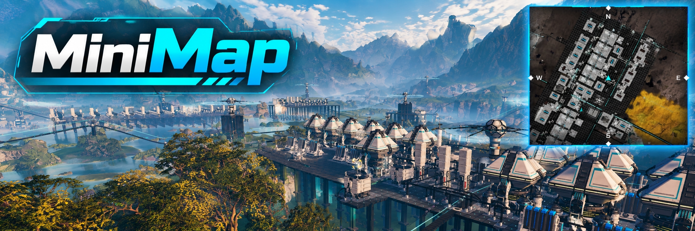
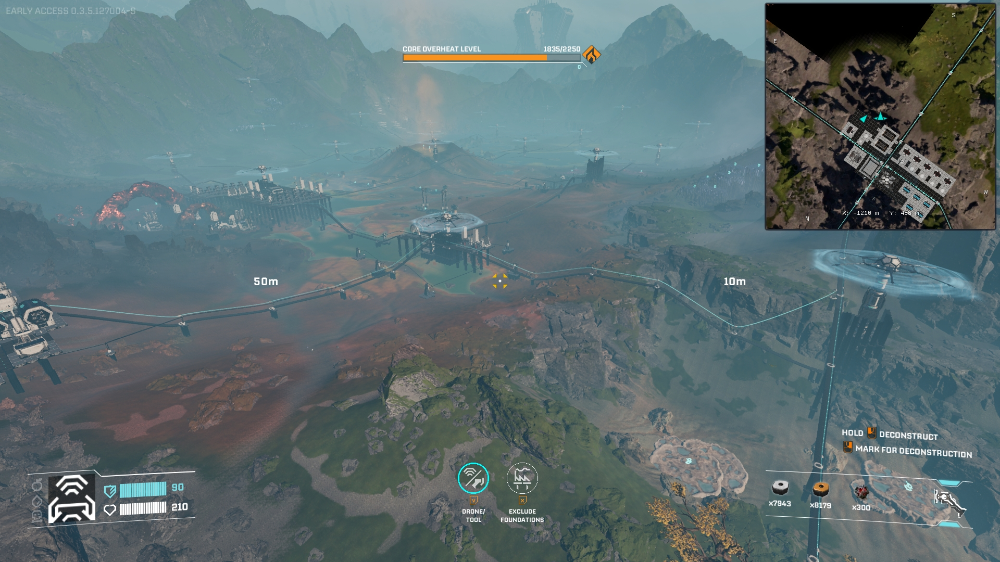
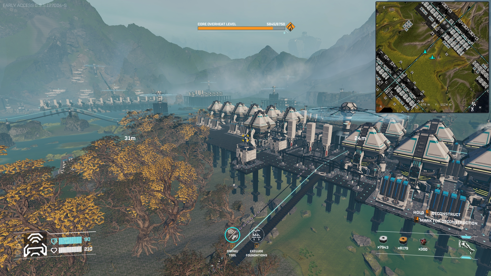
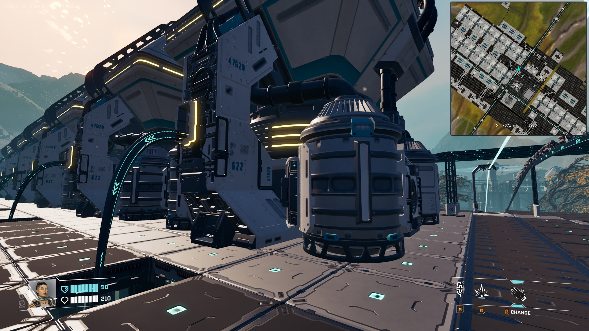
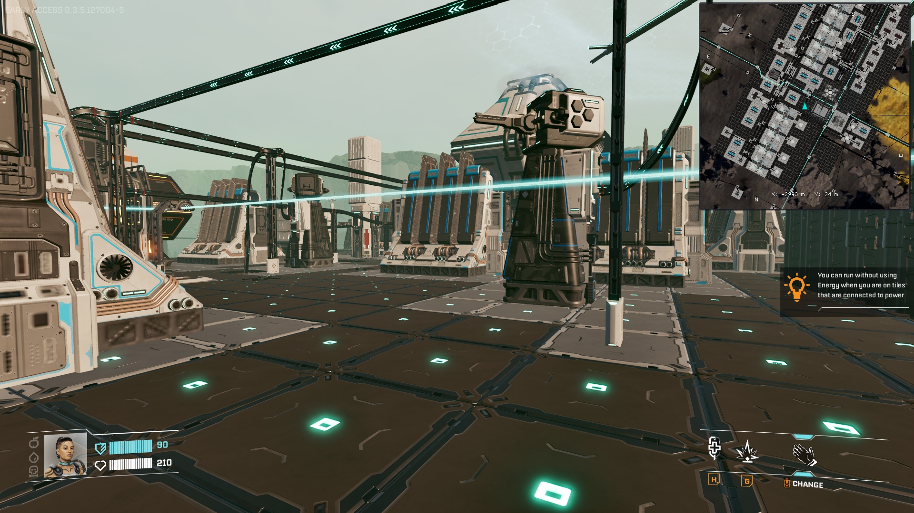

# MiniMap for StarRupture

[Watch the MiniMap Showcase on YouTube](https://www.youtube.com/watch?v=YOeobJEK2S4)

**Stop opening the full map just to work out where you are.**

MiniMap adds a persistent, resizable HUD map showing the surrounding terrain, your direction of travel, exploration progress, and important markers. Keep track of your surroundings and nearby buildings while exploring or working on your factory, without repeatedly opening the full world map.

MiniMap is a client-side, display-only plugin for StarRupture. It reads live game state and does not change saved game data or world progression.

## What's New in MiniMap

### Building Visualization

See recognizable top-down representations of your buildings on the minimap. Factory layouts and production facilities appear as building imagery, helping you relate the map to what you have constructed.

### Transport Networks and Layering

Walkways, drone rails, and ziplines appear alongside your buildings. Building and transport layering keeps overlapping structures and connections readable as you navigate your base.

### Nearby Hostile Aliens

Nearby hostile alien markers help you keep track of observed enemies around you. Their display can be controlled independently through the settings.

### Display and Tracking Customization

Choose a rotating, heading-up map or a north-up view, show or hide coordinates and compass indicators, and choose whether MiniMap follows your active building drone or your character. Building, marker, and other display settings let you tailor the map to how you play.

### Customizable Controls

Customize the show/hide keybinding, mouse-wheel zoom modifier, zoom step, and optional zoom-in and zoom-out keys through AlienX ModLoader. The default controls are listed below.

### Automatic Menu Hiding

MiniMap hides automatically while certain full-screen menus are open, keeping it out of the way while you use those screens.

### Cached Building Imagery

Automatic building discovery and cached imagery help MiniMap display your surroundings without starting the same image preparation from scratch each time. Initial processing can take longer in large bases; see Building Cache below.

### Performance and Stability Improvements

MiniMap includes improvements to building-image processing, caching, and resource handling to support smoother operation and stability.

## Map and Marker Behavior

MiniMap shows live terrain, your position, compass indicators, and native map markers. These include caves, antennas, obelisks, abandoned bases, completed Abandoned Base markers, the Forgotten Engine, and other eligible landmarks, along with Drone and Dead Body markers.

MiniMap follows the game's native marker and Fog of War visibility rules where applicable:

- Disabling Drone or Dead Body markers on the native StarRupture map also hides them on MiniMap.
- POIs hidden by unexplored Fog of War remain hidden when MiniMap's fog is enabled.
- Looted or otherwise ineligible Drone and Dead Body markers disappear automatically when the game no longer considers them eligible to be shown.

MiniMap's visual Fog of War can be disabled through its settings. This does not change your exploration progress.

## Usage

MiniMap starts automatically after a world has loaded.

| Default control | Action |
| --- | --- |
| F4 | Show or hide MiniMap. |
| Left Alt + Mouse Wheel | Zoom in or out. |
| F2 | Open AlienX ModLoader's in-game menu. |

Move or resize MiniMap through the ModLoader UI as you would any other plugin window. Its position and size are remembered by ModLoader. Use the in-game menu to customize its display, tracking, and controls.

No save conversion, setup process, or manual map initialization is required.

## Building Cache

MiniMap discovers buildings automatically and caches building imagery for reuse. The first visit to a large base can take longer while its buildings are processed, so imagery may take time to appear. Subsequent loading benefits from compatible cached data instead of preparing the same building imagery again.

## Screenshots

## Requirements

- StarRupture.
- [AlienX Mod Loader](https://www.nexusmods.com/starrupture/mods/89).

Download compatible releases of MiniMap and AlienX Mod Loader. Technical compatibility details are available in the documentation linked below.

## Installation

1. Install AlienX Mod Loader, then download the MiniMap Client Release ZIP.
2. Right-click StarRupture in Steam and select **Manage > Browse local files**.
3. Navigate to `StarRupture\Binaries\Win64\ModLoader\` and extract the ZIP there. Its `Plugins/` folder places `MiniMap.dll`, `MiniMap.json`, and `MiniMap.pdb` in `StarRupture\Binaries\Win64\ModLoader\Plugins\`.

Alternatively, copy those three files from the archive directly into `ModLoader\Plugins\`.

Start StarRupture and load a world. Press **F4** to show or hide MiniMap.

## Two Mods - One Connected World

**MiniMap** helps you navigate your immediate surroundings and see nearby buildings while playing.

**[MainMap](https://www.nexusmods.com/starrupture/mods/155)** gives you the bigger picture, displaying your constructed world on StarRupture's native world map.

Together, they provide a complementary mapping experience, whether you are exploring, expanding your factory, or managing a transport network. MainMap is an optional companion; MiniMap does not require it.

## Safety and Save Compatibility

MiniMap is a display-only client plugin. It does not reindex entities, rewrite or repair saves, alter persistent IDs, or modify world progression.

## Source Code and License

The source code is available in the [MiniMap GitHub repository](https://github.com/LetMeInside/StarRupture-Plugin-MiniMap) under the MiniMap Source Available License. See [LICENSE](LICENSE) for details.

Copyright (c) 2026 Kian369 (LetMeInside on GitHub). All rights reserved.

## Contributions

Contributions are welcome subject to review. External copyrightable contributions require agreement to the [Contributor Assignment and License Agreement](CLA.md) and an appropriately executed written copyright assignment before merge. See [CONTRIBUTING.md](CONTRIBUTING.md) for the limited contribution permission, execution requirements and submission process.

## Technical Documentation

Developers and players seeking technical details can read the [Technical Documentation](Docs/README.md), including [Compatibility and Version Resolution](Docs/ModLoader/Compatibility-and-Version-Resolution.md).

## Reporting Issues

When reporting a problem, please include:

- Your StarRupture game version/build and AlienX Mod Loader version.
- Whether it occurs in single-player, local multiplayer, remote multiplayer, or a dedicated-server session.
- What you were doing when the problem occurred.
- Relevant Mod Loader log output, if available.

For marker problems, also mention whether the corresponding marker is visible and enabled on the normal in-game map.
